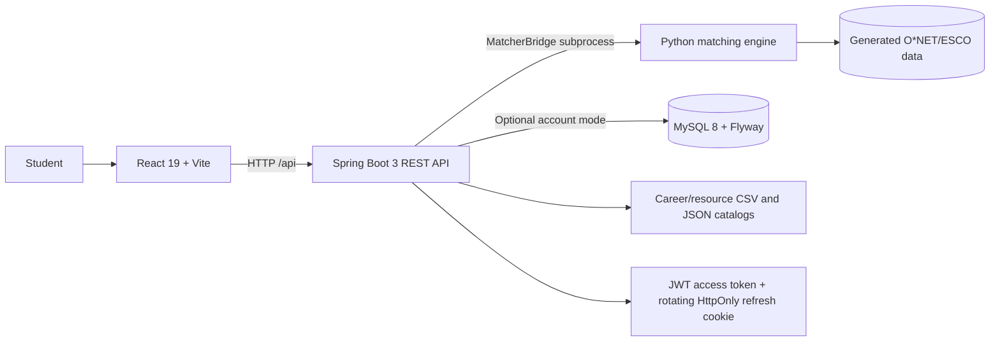

# Architecture

The matching formula remains in `data_processing/matching_engine.py`; Java delegates matching and what-if requests through `MatcherBridge`. Guest profiles stay in browser storage. When account mode is enabled, verified user IDs scope relational persistence. Catalog search and learning resources are read-only and use generated occupation files plus a curated resource catalog. Generated `data/processed/` is intentionally excluded from Git; the clean-clone delivery method remains a deployment decision.
